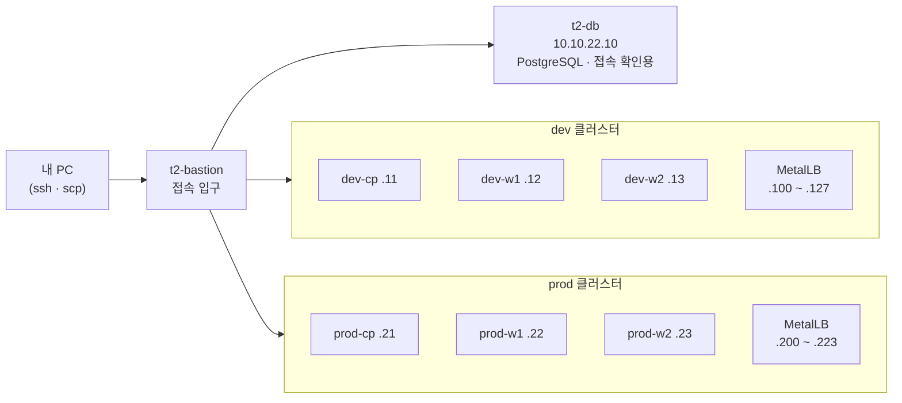

# 클러스터 구축 기록 — 피크오더 dev · prod

> 빈 Ubuntu VM 6대 위에 쿠버네티스 클러스터 2개(dev · prod)를 직접 세운 기록입니다.
> 절차는 강사 「kubeadm 구축 가이드」를 따랐고, 이 문서는 **우리 팀 값, 통과 기준, 실제로 겪은 문제**를 중심으로 정리했습니다.

| 작업일 | 작업자 | 소요 시간 | Kubernetes |
|---|---|---|---|
| 2026-11-06 | 정진혁 | dev 약 30분 · prod 약 40분 | v1.37.2 |

## 1. 한눈에 보기



- 모든 IP는 `10.10.22.x` (2팀 대역), 파드 대역은 두 클러스터 모두 `10.244.0.0/16`
- 노드는 내 PC에서 `ssh t2-<노드이름>` 한 번으로 bastion을 거쳐 바로 들어갑니다

## 2. 왜 직접 만드나 — 이론 시간(kind)과 달라진 점

| 이론 시간에 겪은 일 | 이유 | 이번에 우리가 설치한 것 |
|---|---|---|
| kind는 만들자마자 노드 Ready | kind가 네트워크(CNI)를 미리 깔아 둠 | **Calico** — 노드가 달라도 파드끼리 통신 |
| `type: LoadBalancer`의 EXTERNAL-IP가 계속 `<pending>` | 외부 IP를 나눠 줄 담당자가 없음 | **MetalLB** — 강사가 정해 준 팀 대역에서 IP를 자동 배정 |
| PVC가 바로 Bound | kind가 저장소(StorageClass)를 미리 깔아 둠 | **local-path** — 노드 디스크에 저장 공간 연결 |
| 외부 요청을 서비스로 나누는 입구 | API Gateway 단원에서 별도 실습 | **Envoy Gateway** — 피크오더 API의 입구 |

## 3. 구축 단계와 통과 기준

| # | 단계 | 어디서 | 핵심 명령 | 통과 기준 |
|---|---|---|---|---|
| 1 | 스크립트 배포 | 내 PC | `scp node-prep.sh t2-<노드>:~/` | 3대 모두 100% |
| 2 | 노드 준비 | 노드 3대 | `bash node-prep.sh` | `SystemdCgroup = true` · containerd 2.2.1 · kubeadm v1.37.2 |
| 3 | control plane | cp | `sudo kubeadm init --pod-network-cidr=10.244.0.0/16 --apiserver-advertise-address=<cp IP>` | `initialized successfully!` |
| 4 | kubectl 설정 | cp | `~/.kube/config` 복사 | `kubectl get nodes`에 cp 표시 |
| 5 | 워커 합류 | w1 · w2 | init 출력의 `kubeadm join ...` 앞에 `sudo` | `This node has joined the cluster` → 사용한 토큰 삭제 |
| 6 | Calico | cp | `custom-resources.yaml`의 `cidr`, `encapsulation` 두 줄 수정 후 적용 | 1분 뒤 노드 3대 Ready |
| 7 | 파드 통신 검사 | cp | nginx 4개 + busybox로 wget | 4/4 OK (w1 · w2에 나눠 배치) |
| 8 | MetalLB | cp | 팀 대역으로 IPAddressPool · L2Advertisement | Service EXTERNAL-IP가 대역 첫 번호 |
| 9 | local-path | cp | 기본 StorageClass 지정 | 테스트 PVC Bound, 파일 읽기 OK |
| 10 | Envoy Gateway | cp | helm 설치 → Gateway · HTTPRoute | ADDRESS가 대역 다음 번호, PROGRAMMED True |
| 11 | 외부 접속 검사 | t2-db | `curl` LoadBalancer · Gateway 주소 | HTTP 200 |
| 12 | 정리 | cp | 테스트용 web · pvc-test · gateway 삭제 | 설치한 구성요소만 남음 |

**Calico에서 반드시 바꾸는 두 줄**

```
cidr: 10.244.0.0/16      # kubeadm init의 --pod-network-cidr와 같게
encapsulation: VXLAN     # 기본값 VXLANCrossSubnet이면 다른 노드 파드 통신이 막힘
```

## 4. 검증 결과

| 검사 | dev | prod |
|---|---|---|
| 노드 상태 | 3대 Ready | 3대 Ready |
| 다른 노드 파드 간 통신 | 4/4 OK | 4/4 OK |
| LoadBalancer IP | `10.10.22.100` → 200 | `10.10.22.200` → 200 |
| 저장소 | PVC Bound, 저장 확인 | PVC Bound |
| Gateway 주소 | `10.10.22.101` → 200 | `10.10.22.201` → 200 |

MetalLB는 대역 앞번호부터 나눠 줍니다. 테스트 서비스가 첫 번호, Gateway가 다음 번호를 받았습니다.

## 5. 자주 헷갈리는 점

터미널 창이 여러 개라 **지금 어느 컴퓨터에 있는지**를 놓치기 쉽습니다. 아래 증상이 보이면 먼저 프롬프트를 확인합니다.

| 증상 | 원인 | 해결 |
|---|---|---|
| `scp: stat local ... No such file or directory` | 노드 안에서 scp를 실행함 (scp는 내 PC의 파일을 보냄) | `exit`로 내 PC에 돌아와 실행 |
| `kubectl: command not found` | control plane이 아닌 곳(워커, DB VM)에서 실행함 | kubectl은 control plane에서만 |
| Gateway ADDRESS 비어 있음, PROGRAMMED Unknown | 만든 직후 준비 중 | 10~20초 뒤 다시 조회 |
| `AlreadyExists`, `unchanged` | 같은 명령을 한 번 더 실행함 | 이미 만들어진 것이라 무시해도 됨 |

**프롬프트로 위치 확인하기**

| 프롬프트 | 위치 | 여기서 하는 일 |
|---|---|---|
| `PS C:\Users\...>` | 내 PC | ssh, scp |
| `lab@t2-dev-cp` / `lab@t2-prod-cp` | control plane | kubeadm init, kubectl |
| `lab@t2-*-w1` / `w2` | 워커 | kubeadm join |
| `lab@t2-db` | DB VM | curl로 외부 접속 확인 |

## 6. dev → prod로 바꿀 값

| 바뀌는 곳 | dev | prod |
|---|---|---|
| 노드 | `.11 · .12 · .13` | `.21 · .22 · .23` |
| `--apiserver-advertise-address` | `10.10.22.11` | `10.10.22.21` |
| MetalLB 풀 | `dev-pool` · `.100-.127` | `prod-pool` · `.200-.223` |

나머지 명령과 파일은 그대로 다시 썼습니다.

## 7. 이 클러스터 위에 올라갈 것

| 구성요소 | 피크오더에서 쓰는 곳 |
|---|---|
| Envoy Gateway | 고객 화면 · 운영자 화면의 API 입구, 경로별로 6개 서비스(menu · order · kitchen · congestion · auth · admin)에 전달 |
| MetalLB | Gateway에 고정 IP 부여 (dev `.101`, prod `.201`) |
| local-path | 메시지 큐 · 모니터링(Prometheus · Loki)처럼 데이터를 남겨야 하는 파드의 저장소 |
| dev / prod 분리 | main 머지 → dev 자동 배포로 확인 → prod에서 시연·부하 테스트 |

local-path는 데이터가 **파드가 뜬 노드 한 대의 디스크**에만 있습니다. 그 노드가 꺼지면 해당 파드는 다른 노드로 옮겨 가지 못하므로, prod에서 지켜야 할 데이터는 백업 방법을 따로 정합니다 [미정].

## 8. 지키는 것

- `admin.conf`, `~/.kube/config`, join 토큰은 저장소·채팅에 올리지 않습니다. join이 끝나면 토큰은 바로 삭제합니다
- 노드는 lab 계정을 팀이 같이 씁니다. 구축·변경은 한 사람이 하고, 시작 전에 단톡에 알립니다
- 처음부터 다시 만들 때는 강사 가이드 12절(`kubeadm reset`) 순서를 따릅니다

## 파일

| 파일 | 내용 |
|---|---|
| `node-prep.sh` | 노드 준비(swap 끄기 · 커널 설정 · containerd · kubeadm 설치)를 한 번에 실행하고 마지막에 확인 결과를 출력 |
