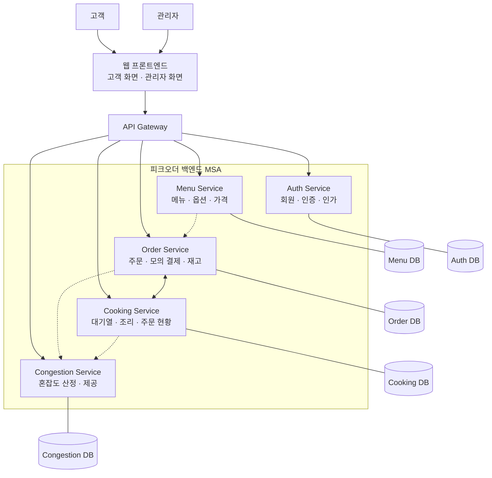

# 시스템 아키텍처

[← 요구사항](requirements.md) · [README](../README.md) · [기술 스택](tech-stack.md) · [미결정 사항](pending-decisions.md)

> 문서 상태: **초안 · 팀 전체 승인 필요**
> 이 문서의 ‘확정’은 팀 승인 근거가 확인된 경우에만 사용합니다. 현재 제공 자료만으로 최종 승인이 확인된 항목은 없습니다.
> 자료 기준: 첨부 Notion ZIP의 본문입니다. 웹 원문을 다시 읽은 것으로 간주하지 않으며, 원본의 최신 순서나 승인 여부를 추정하지 않습니다.

## 원본 자료

- 원본 Notion 문서: [아키텍처 설계](https://puzzling-woolen-3e9.notion.site/40f2f07e9478800e9985d80e19ebe7d2?source=copy_link)
- 원본 Notion 문서: [Project Canvas · 프로젝트 기획서](https://puzzling-woolen-3e9.notion.site/Project-Canvas-2fb2f07e94788325a23781f07768b193?source=copy_link)
- 원본 Notion 문서: [요구사항](https://puzzling-woolen-3e9.notion.site/40f2f07e9478807e9247f4aa28eb3348?source=copy_link)
- 원본 Notion 문서: [설계 결정 기록](https://puzzling-woolen-3e9.notion.site/40f2f07e947880e79b0bd511e54367a5?source=copy_link)

## 정리 범위

- 기존 GitHub 파일의 서비스 A/B, 예시 타임아웃, GHCR·Trivy·운영 승인 후 배포 그림은 템플릿으로 확인했습니다. 해당 예시를 피크오더의 확정 설계로 옮기지 않았습니다.
- 아래는 Notion 아키텍처 본문의 설명·책임 표·Mermaid를 보존한 5개 서비스 안입니다. Notion 원문에도 서비스 수와 범위 불일치가 있습니다.
- 로그인·관리자 기능은 승인 범위가 일치하지 않습니다. 실제 서비스 폴더나 DB를 새로 만들지 않았습니다.

## 1. 아키텍처 개요

### 1.1 설계 목적

피크오더는 음식 주문 및 조리 대기 시뮬레이션 웹 서비스다.

일반 유저는 메뉴를 선택하고 모의 결제를 통해 주문한 후, 공용 전광판에서 주문 진행 상태와 예상 대기 시간 및 매장 혼잡도를 확인할 수 있다.

본 프로젝트는 기능 구현뿐 아니라 다음 기술 목표를 검증하는 데 목적이 있다.

- MSA 기반 독립적인 서비스 개발 및 배포
- Kubernetes 환경의 배포 자동화
- 서비스별 메트릭과 중앙 로그 수집
- 주문 집중 및 장애 상황의 관측과 복구
- 동시 주문 상황에서의 데이터 정합성 유지

### 1.2 주요 설계 원칙

> **원문 설계 제안 · 최종 구성 미결정.** 아래의 “5개의 MSA”는 아키텍처 문서의 제안이며 최종 확정되지 않았습니다. 설계 결정 기록의 3개, 기획서의 6개 서비스 안과 차이가 있어 [PD-01](pending-decisions.md#pd-01)에 따라 팀 전체 확인이 필요합니다. 아래 원문 문장을 확정된 구성으로 해석하지 않습니다.

- 백엔드는 5개의 MSA로 분리한다.
- 각 서비스는 자신의 업무 데이터에 대한 책임을 갖는다.
- 서비스별 DB를 논리적으로 분리한다.
- 서비스 간 데이터 교환은 명시적인 인터페이스를 통해 수행한다.
- 주문·재고·조리 상태의 일관성을 유지한다.
- 단순 조리 대기 증가와 시스템 장애를 구분한다.
- 기술적 필요만으로 초기 MVP 범위를 불필요하게 확장하지 않는다.

---

> **상태: 제안 · 최종 구성 미결정.** 아래는 아키텍처 원문의 5개 서비스 안입니다. 결정 기록의 3개, 기획서의 6개와 다릅니다. “2.2 서비스 분리 이유”의 “세 서비스” 표현도 원문 내부 불일치이므로 보존하고 확인 대상으로 기록했습니다. [PD-01](pending-decisions.md#pd-01) 참고.

## 2. MSA 서비스 분리

### 2.1 백엔드 서비스 구성

| 서비스 | 담당 영역 | 주요 책임 |
| --- | --- | --- |
| Menu Service | 메뉴 관리 | 메뉴·옵션·가격 조회 및 제공 |
| Order Service | 주문·결제·재고 | 주문 생성·취소, 모의 결제, 재고 확보·확정·반환 |
| Cooking Service | 조리·대기열 | FIFO 대기열, 조리 진행, 예상 대기 시간, 공용 전광판 |
| Congestion Service | 매장 혼잡도 관리 | 주문량·대기열 분석, 혼잡도 산정, 혼잡 상태 제공 |
| Auth Service | 회원·인증 관리 | 회원가입·로그인, 사용자 인증, 고객·관리자 권한 관리 |

### 2.2 서비스 분리 이유

업무 책임을 기준으로 세 서비스를 분리하여 독립적인 개발·배포가 가능하도록 한다.

또한 서비스마다 발생하는 요청량, 지연, 오류, 장애를 개별적으로 관측할 수 있도록 한다.

### 2.3 책임 경계

**Menu Service**

- 메뉴 목록·상세 정보 제공
- 옵션과 가격 정보 관리

**Order Service**

- 주문 생성 및 주문번호 발급
- 재고 임시 확보와 확정 차감
- 모의 결제 처리 및 1분 만료
- 취소 확정에 따른 주문 상태 변경과 재고 복원

**Cooking Service**

- 공용 FIFO 대기열 운영
- 조리 시작 및 완료 처리
- 예상 대기 시간 계산
- 주문 취소 가능 여부 최종 판단
- 공용 전광판 데이터 제공

**Congestion Service**

- 주문량·조리 대기열 정보를 기반으로 혼잡도 산정
- 혼잡 상태(원활·혼잡·포화) 제공
- 혼잡도 변경 이력 관리
- 주문 접수 제한 판단에 필요한 상태 정보 제공

**Auth Service**

- 고객 회원가입·로그인·로그아웃
- 사용자 인증 및 계정 관리
- 고객·관리자 역할 구분
- 접근 권한 정책 관리 및 인증 정보 제공

---

## 3. 시스템 구성

### 3.1 시스템 컨텍스트

피크오더는 고객과 매장 관리자를 주요 이용 주체로 한다.

- 고객: 회원가입·로그인, 메뉴 조회, 장바구니, 모의 결제, 주문 상태 및 혼잡도 확인
- 관리자: 메뉴·재고 관리, 주문·조리 현황 조회 및 혼잡도 관리
- 공용 전광판에는 매장 혼잡도와 실시간 주문 현황을 표시

실제 결제 대행사 연동, 배달 서비스 및 외부 알림 서비스는 구현 범위에서 제외한다.

### 3.2 프론트엔드 구성

| 화 | 담당 영역 | 주요 기능 |
| --- | --- | --- |
| Customer Page | 고객용 화면 | 메뉴 조회, 장바구니, 주문·결제, 혼잡도 및 실시간 주문 현황 표시 |
| Admin Page | 관리자용 화면 | 메뉴·재고 관리, 주문·조리 현황 조회 및 운영 관리 |

> **5개 서비스 안의 원문 다이어그램입니다. 확정 구성도나 구현 현황이 아닙니다.** 점선만으로 특정 메시지 큐나 비동기 프로토콜이 선정됐다고 해석하지 않습니다.

### 3.3 전체 아키텍처

논리적 구조:

사용자 → 웹 프론트엔드 → API Gateway → Menu / Order / Cooking / Congestion / Auth Service

### 3.4 서비스 간 연결

| 연결 | 목적 |
| --- | --- |
| 프론트엔드 ↔ 메뉴 | 메뉴·옵션·가격 조회 |
| 프론트엔드 ↔ 주문 | 결제·주문·취소 |
| 프론트엔드 ↔ 조리 | 전광판 조회 |
| 프론트엔드 ↔ 혼잡도 | 매장 혼잡도 조회 및 관리 |
| 프론트엔드 ↔ 인증 | 회원가입·로그인 사용자 인증 |
| 메뉴 ↔ 주문 | 주문에 필요한 메뉴 정보 교환 |
| 주문 ↔ 조리 | 확정 주문 전달, 상태 변경, 취소 처리 |
| 주문 ↔ 혼잡도 | 혼잡도 산정에 필요한 주문량 정보 제공 |
| 조리 ↔ 혼잡도 | 혼잡도 산정에 필요한 대기·대기 시간 정보 제공 |

---

> **상태: 설계 초안 · 승인 필요.** 데이터 책임과 취소 판단 주체는 원문 설계안입니다. DB의 실제 배치, 통신 적용 위치·제품, 동시 요청·실패 복구 세부 로직은 미결정입니다. 장애 시 기능 제한의 구체 기준도 팀 확인이 필요합니다.

## 4. 데이터 소유권 및 서비스 간 통신

### 4.1 데이터 소유권

| 서비스 | 소유 데이터 |
| --- | --- |
| Menu Service | 메뉴, 옵션, 가격 |
| Order Service | 주문, 모의 결제, 재고 및 재고 확보 |
| Cooking Service | 조리 대기열, 조리 상태, 예상 대기 시간 |
| Congestion Service | 혼잡 등급, 혼잡도 산정 결과 및 변경 이력 |
| Auth Service | 회원 계정, 인증 정보, 사용자 역할 및 권한 |

다른 서비스의 DB를 직접 수정하지 않고 서비스 간 인터페이스로 필요한 정보를 교환한다.

### 4.2 서비스 간 통신

동기와 비동기 통신을 상황에 맞게 혼합한다.

- 즉시 결과가 필요한 작업: 동기 통신 검토
- 결과를 즉시 기다리지 않아도 되는 작업: 비동기 통신 검토
- 실제 적용 위치와 구체적인 통신 기술: 미결정

### 4.3 주문 취소 정책

- 조리 시작 전에는 주문 취소 가능
- 조리 시작 후에는 주문 취소 불가
- 취소 가능 여부는 Cooking Service가 최종 판단
- 취소 결과에 따른 주문 상태 변경과 재고 복원은 Order Service가 담당
- 취소 요청과 자동 조리 시작이 충돌할 때 모순된 결과가 발생하지 않아야 함

### 4.4 장애 처리 기본 정책

| 유형 | 정의 및 기본 정책 |
| --- | --- |
| 가용성 장애 | 필수 기능을 정상적으로 제공할 수 없는 상태. 장애의 영향을 받는 기능을 제한하되 다른 정상 기능은 유지한다. |
| 성능 장애 | API 응답시간, 오류율 등의 지표가 허용 기준을 벗어나 정상 처리를 방해하는 상태. 관측 결과를 기준으로 대응하고, 단순 대기는 제외한다. |
| 데이터 장애 | 데이터의 저장 일관성 또는 처리 결과의 정확성을 보장할 수 없는 상태. 신규 처리보다 데이터 보호와 정합성 확인을 우선한다. |
- 장애 발생 시 전체 서비스 중단을 최소화 하고, 영향 범위에 따라 제공할 수 있는 기능은 유지한다
- 핵심 기능을 안전하게 처리할 수 없는 서비스의 작업은 제한한다
- 이미 확정된 주문 데이터를 임의로 삭제하거나 중복 처리하지 않는다
- 처리 결과가 불명확할 때는 임의로 성공과 실패를 정하지 않는다
- 장애 복구 시에는 데이터 정합성과 처리 가능 여부를 확인 후 정상 운영을 재개한다

---

> **상태: 미작성.** 아래 세 시퀀스는 원문에서도 삽입 예정입니다. 검토 항목만 보존하고 새 그림이나 API 순서를 만들지 않았습니다.

## 5. 핵심 시퀀스 설계

### 5.1 정상 주문 시퀀스

**[시퀀스 다이어그램 삽입 예정]**

검토할 내용:

- 주문 시 메뉴 정보 확인
- 재고 임시 확보
- 모의 결제 및 확정 차감
- 주문 생성과 주문번호 발급
- 조리 대기열 등록
- 주문 확정과 대기열 등록의 실패 처리

### 5.2 주문 취소 시퀀스

**[시퀀스 다이어그램 삽입 예정]**

검토할 내용:

- 취소 요청과 처리 주체
- 조리 시작 여부 확인 및 취소 승인
- 대기열 제거
- 주문 상태 변경과 재고 반환
- 동시 요청과 서비스 장애 시 처리

### 5.3 장애 처리 시퀀스

**[시퀀스 다이어그램 삽입 예정]**

검토할 내용:

- 조리 서비스 장애 감지
- 신규 주문 접수 제한
- 진행 중인 결제 및 주문 처리
- 장애 복구와 주문 데이터 재동기화
- 주문 접수 재개

---

> **상태: 미작성·미결정.** 아래는 배치 검토 항목이며 배포 구성도가 아닙니다. 기존 [배포 README](../deploy/README.md)의 환경 값과 설명은 변경하지 않았고, Notion과의 일치 여부는 [PD-06·15](pending-decisions.md)에서 확인 대상으로 둡니다.

## 6. Kubernetes 배포 아키텍처

검토 항목:

- 개발(dev)과 운영(prod) 클러스터 배치
- 프론트엔드 및 백엔드 서비스 배포 구조
- Gateway와 서비스 라우팅
- 서비스별 설정 및 Secret 관리
- PostgreSQL 연결 구조
- 배포·재시작·장애 복구
- 모니터링·로깅 구성 요소의 배치

**[Kubernetes 배포 구성도 삽입 예정]**
